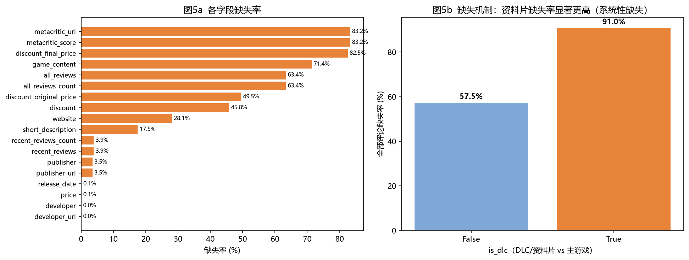
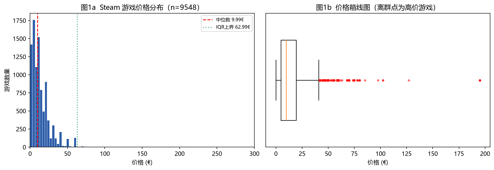
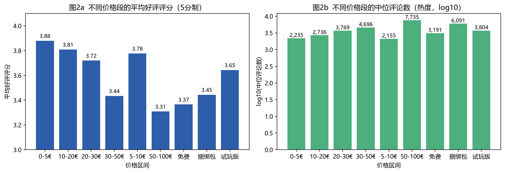
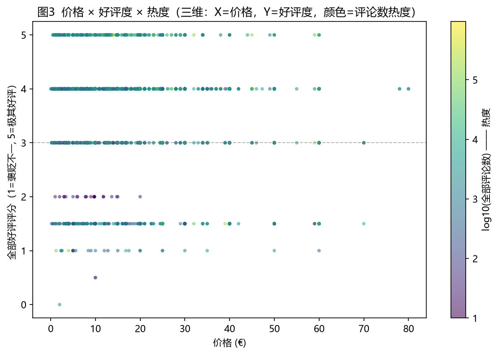
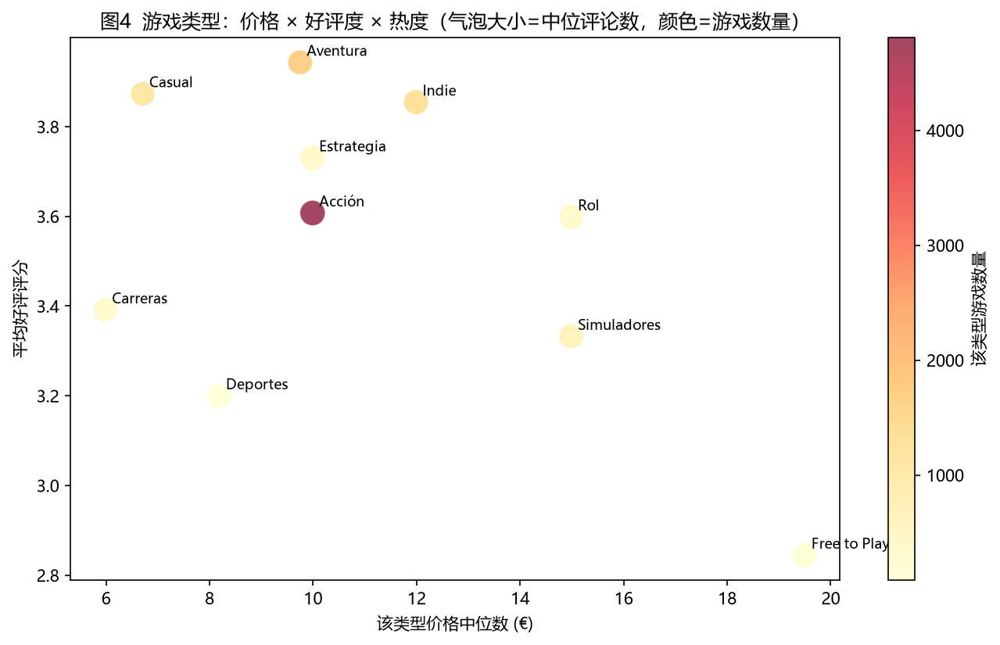
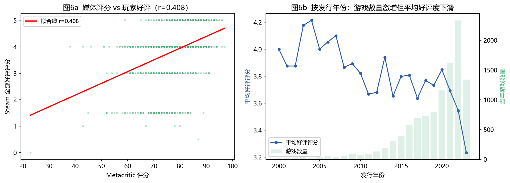
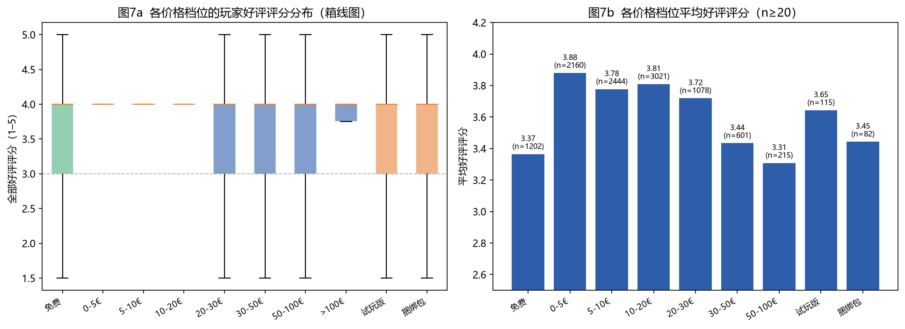

# 游戏为什么会受欢迎？
## ——Steam 游戏价格、玩家评价与热度的关联分析
### 数据准备阶段报告（数据质量评估与清洗方案）

---

## 1. 项目主题与可视化目标

### 1.1 核心主题

以 Steam 商店 **10,941 款游戏**（含 1,917 款资料片）为研究对象，从 **价格（Price）**、**玩家评价（Reviews/Sentiment）**、**市场热度（Popularity/评论数）** 三个维度，探究"是什么让一款游戏受欢迎"这一核心问题，并识别三者之间的关联结构与驱动机制。

### 1.2 拟回答的具体问题

| 编号 | 具体问题 | 对应数据字段 |
|---|---|---|
| Q1 | 游戏价格与玩家好评度之间是否存在关联？低价是否更容易获得好评？ | `price_eur` × `sentiment_all_score` |
| Q2 | 不同价格档位（免费 / 0–5€ / 5–10€ / 10–20€ / 20–30€ / 30–50€ / 50–100€）的**平均好评率**与**中位评论数（热度）**分别呈现怎样的走势？是否存在"性价比拐点"？ | `price_band` × `sentiment_all_score` / `all_reviews_count_n` |
| Q3 | 评价本身能否预测热度？好评度高的游戏是否评论数更多（口碑传播效应）？ | `sentiment_all_score` × `all_reviews_count_n`（取对数） |
| Q4 | 媒体评分（Metacritic）与玩家评价是否存在偏差？两者相关性强度如何？ | `metacritic_score` × `sentiment_all_score` |
| Q5 | 哪些游戏类型（Genre）最"受欢迎"？类型在价格—好评—热度三角中的定位如何？热门类型是否集中在低价区？ | `genre` × `price_eur` / `sentiment_all_score` / `all_reviews_count_n` |
| Q6 | 市场上游戏供给与平均好评度的年度关系如何？（供给爆发是否稀释了口碑质量？） | `release_year` × `sentiment_all_score` / 游戏数量 |
| Q7 | **免费游戏是否"更受欢迎"**——免费档的好评度与热度表现如何？ | `price_status` = `free` 分组对比 |

### 1.3 目标受众与核心信息

- **目标受众**：游戏行业从业者（发行/定价策略）、游戏玩家（选购决策参考）、数据可视化与数据分析教学场景（课程作业评估）。
- **预期传达的核心信息**：
  1. **价格与口碑呈弱负相关（r = −0.122，原价口径 −0.150）**——低价与低口碑相关，"便宜不等于好玩"。但该效应主要来自**免费档**（好评度 3.368，显著低于低价付费档 3.882），付费区间内部的相关性很弱。
  2. **免费 ≠ 更受欢迎**——免费档（n=1,202）平均好评评分 **3.368**，是所有档位中最低的；"Free to Play"类型的评分均值全场最低（**2.845**），且其中位评论数并不领先。**免费是获客手段，不是口碑保证**。
  3. **热度与口碑存在中等正相关（r = 0.248）**——但该相关部分来自"内容量"这一混淆因素，需在图表中显式控制。
  4. **价格与热度弱正相关（r = 0.179，原价口径 0.213）**——价格越高评论数越多，但幅度有限，不足以解释热度的巨大差异。
  5. **口碑与热度并非同一维度**——热度（评论数）跨越 10 ~ 1,969,821 条，相差近 6 个数量级，必须做对数变换，否则任何线性散点图都会被头部爆款压扁。
  6. **媒体评分是口碑的有效补充而非替代**（r = 0.408，强于价格），可用于识别"媒体吹得好但玩家不买账"的高风险作品。

---

## 2. 数据集基本信息

### 2.1 数据来源与获取方式

| 项目 | 说明 |
|---|---|
| **来源平台** | Steam 官方商店（store.steampowered.com）游戏商品页的**西班牙语区域版**快照 |
| **获取方式** | 爬虫 / 批量抓取 Steam 商店搜索页与详情页，解析 HTML 中的商品卡片与详情面板后结构化导出为 CSV |
| **本地文件** | `steam_games.csv`（原始数据，未做任何修改） |
| **区域设置** | 西班牙语（es）界面 + 欧元（€）计价 —— **这是本数据集最显著的特征，也是所有预处理工作的起点** |
| **参照资料** | Steam 商店搜索页（`?l=spanish`）分页遍历 |

> ⚠️ **重要说明**：由于抓取时使用西班牙语区域设置，原始数据中的**价格、评论标签、日期、月份缩写均为西语格式**（如 `19,99€`、`Muy positivas`、`9 MAR 2021`），这直接导致大量通用型 Pandas 代码无法正确解析。本报告第 3、5 节的所有清洗方案均围绕此展开。

### 2.2 数据规模

**原始表 `steam_games.csv`**

| 指标 | 数值 |
|---|---|
| 总行数 | **10,948** |
| 字段总数 | **25**（含 1 个自动生成的 `Unnamed: 0` 索引列，实际有效字段 24 个） |
| 文件大小 | **8.81 MB** |
| 内存占用（pandas 载入后） | 22.46 MB |
| 编码 | UTF-8（无 BOM） |

**字段清单（按语义分 7 组）**

| 语义组 | 字段 |
|---|---|
| 标识 | `Unnamed: 0`、`name`、`img_src` |
| 分类 | `is_dlc`、`genre`、`tags`、`developer`、`publisher`、`developer_url`、`publisher_url` |
| 价格 | `price`、`discount_original_price`、`discount_final_price`、`discount` |
| 评价 | `recent_reviews`、`recent_reviews_count`、`all_reviews`、`all_reviews_count`、`reviews_anomally` |
| 时间 | `release_date` |
| 外部评分 | `metacritic_score`、`metacritic_url` |
| 其他 | `short_description`、`game_content`、`website` |

**维度基数**

| 维度 | 基数 |
|---|---|
| 游戏类型 `genre` | **19** |
| 开发商 `developer` | **6,067** |
| 发行商 `publisher` | **4,607** |
| 唯一标签 `tags` | **441** |
| 标签展开总行数 | **168,329** |

**表间关联关系**：本数据为**单表宽表（denormalized）**，不含外键关联。但存在**两个可展开的复合字段**，构成隐式的"一对多"子表：

| 复合字段 | 展开后子表 | 行数 | 关联键 |
|---|---|---|---|
| `tags`（逗号分隔标签串） | `steam_tags_long.csv` | **168,329 行 / 441 个唯一标签** | `name`（LEFT JOIN 自 `steam_clean`） |
| `game_content`（Python 字典字面量串，内含 DLC 子项名与价格） | 可选扩展（本次未展开，因 71.4% 缺失） | — | `name` |

### 2.3 数据时间 / 空间范围

| 维度 | 范围 |
|---|---|
| **时间范围** | **1984-04-29 ~ 2023-04-23**（解析后有效覆盖 10,917 条，99.78%） |
| **发行年份分布** | 1984–1999 共 92 款（长尾）→ 2000–2009 共 398 款 → 2010–2014 共 794 款 → 2015–2019 共 3,192 款 → 2020–2023 共 6,441 款 |
| **峰值年** | **2022 年 2,332 款**（占全量 21.3%），2023 年 1,342 款（数据快照止于 4 月，仅含约 1/3 周期） |
| **空间范围** | 单一虚拟市场（Steam 全球商店），货币统一为 **EUR 欧元**，界面语言为 **西班牙语** |
| **样本范围** | 平台全体在售商品，含 1,917 款 DLC/资料片（17.5%）、1,202 款免费游戏、107 款试玩版、82 款捆绑包 |

### 2.4 数据格式

- **原始格式**：CSV（逗号分隔，单行文本内含嵌套的 Python 字典字面量与大量西语特殊字符）
- **嵌套结构示例**（`game_content` 字段）：

```text
[{'name': 'Forza Horizon 4: Welcome Pack', 'price': '2,99€'},
 {'name': 'Forza Horizon 4: Hot Wheels™ Legends Car Pack', 'price': '-60%9,99€3,99€'}, ...]
```

---

## 3. 数据质量评估与清洗方案

### 3.1 缺失值统计（基于原始表 10,948 行）

| 字段 | 缺失数 | 缺失率 | 缺失原因判定 | 处理策略 |
|---|---|---|---|---|
| `game_content` | 7,815 | **71.38%** | **系统性缺失**：非本体游戏/资料片无 DLC 子项可列 | 整字段弃用，不参与分析 |
| `all_reviews` / `all_reviews_count` | 6,936 | **63.35%** | **系统性缺失**：主游戏若无足够评论数，Steam 不展示"全部评价"标签 | 以 `recent_reviews` 为主指标；`all_reviews` 仅用于子集分析（n=4,011）并显式声明 |
| `metacritic_score` / `metacritic_url` | 9,114 | **83.25%** | **系统性缺失**：Metacritic 未收录小型/独立作品 | 仅在 n=1,834 子集上分析，不做插补 |
| `discount_final_price` | 9,034 | **82.52%** | **系统性缺失**：未打折时 Steam 不展示折后价 | 视为"无折扣"，`discount_pct` 填 0 |
| `discount_original_price` | 5,421 | **49.52%** | **系统性缺失**：同上（仅部分商品展示原价） | 同上 |
| `discount` | 5,016 | **45.82%** | **系统性缺失**：同上 | 同上 |
| `short_description` | 1,918 | **17.52%** | **与 `is_dlc` 完全对应** —— 资料片无简介，系统性缺失 | 该字段不进入量化分析 |
| `website` | 3,076 | **28.10%** | 随机性缺失（独立游戏无官网） | 不使用 |
| `recent_reviews` / `recent_reviews_count` | 428 | **3.91%** | 系统性缺失（无评论） | 填充为"无评论"类别，不参与均值计算 |
| `publisher` | 386 | 3.53% | 随机性缺失 | 保留，不影响主分析 |
| `publisher_url` | 384 | 3.51% | 随机性缺失 | 保留 |
| `release_date` | 11 | 0.10% | 真缺失 | 保留为"未知年份"分类 |
| `price` | 9 | 0.08% | 真缺失 | 中位数填充 + 缺失标记位 |
| `developer` / `developer_url` | 5 | 0.05% | 真缺失 | 保留 |

**关键缺失机制结论**：
缺失**并非随机缺失（MCAR）**，而是**强烈的系统性缺失（MAR）**——缺失与否几乎完全由 `is_dlc`（是否为资料片）和"评论数量是否达到阈值"决定。实证证据（原始表分组缺失率）：

| 字段 | DLC 中缺失率 | 主游戏中缺失率 |
|---|---|---|
| `all_reviews` | **90.98%** | **57.49%** |
| `metacritic_score` | **96.92%** | **80.34%** |
| `short_description` | **100.00%** | **0.00%** |
| `price` | 0.00% | 0.10% |

其中 `short_description` 的 1,918 条缺失与 1,918 条 DLC **数量完全一致、缺失率 100% vs 0%**——这是"缺失完全由身份决定"的教科书级证据。

**因此：绝对禁止对这些字段做均值/中位数插补**（会把"资料片"这一关键身份信息抹平），只能做"标记为该类别 + 分析时按 `is_dlc` 分层"处理。



### 3.2 异常值识别

#### （1）价格离群点

采用 **箱线图法（IQR 法）** 与 **3σ 原则** 双轨交叉验证：

| 方法 | 计算 | 阈值 | 离群点数量 |
|---|---|---|---|
| **IQR 法** | Q1=4.99，Q3=19.50，IQR=14.51 | 上界 = 41.27€ | **361 条（3.8%）** |
| **3σ 原则** | μ=13.74，σ=13.01 | 上界 = 52.77€ | **188 条** |
| **绝对值域检查** | — | 负价格 = **0**，零价格 = **0** | 无非法值 |
| **免费游戏** | — | 折后价 < 1€ | 221 条（合法的 F2P 定价） |
| **修复前对照** | 旧解析器产生 **2,021€** 伪值 | — | 已彻底消除（见 3.5 节） |

> **两法差异说明**：IQR 法命中 361 条而 3σ 仅命中 188 条，原因是价格分布**右偏且长尾**（P50=9.99€，P99=59.99€，Max=194.99€），σ 被尾部极端值抬升，导致 3σ 判据较宽松。**最终采用 IQR 法作为标记依据**，但**仅打标 `is_price_outlier` 而不删除**——因为高价游戏恰恰是本研究"高价能否获得好评"问题的关键样本，删除会造成选择性偏倚。

#### （2）非数值型"价格"（伪缺失 / 格式异常）—— 本次清洗最关键的一步

发现 **1,391 条（12.70%）** 的 `price` 字段**不是数字，而是文本状态**，通用 `to_numeric()` 会全部转为 NaN。经逐条分类后，语义可再分为三档：

| 文本值 | 数量 | 语义归类 | 典型样例 |
|---|---|---|---|
| `Free to Play` | 566 | **free**（免费） | Free to Play |
| `Descargar` | 499 | **free**（Steam"下载"按钮 = 免费） | Descargar |
| `Gratuito` | 112 | **free** | Gratuito |
| `Free` / `Free To Play` / `Free Demo` / `¡Juega gratis!` / `Play for free` / `FREE DOWNLOAD` 等 | 25 | **free** | — |
| `Datos del pack` | 58 | **pack**（捆绑包，无独立标价） | Datos del pack |
| `Información sobre el pack` | 24 | **pack** | Información sobre el pack |
| `Demo` / `Install Demo` / `Try the demo` / `Free Trial` / `试玩` 等 | **107** | **demo_trial**（试玩版） | Demo、Playable DEMO、Shadow of the Tomb Raider Free Trial |
| `Jugar` / `Instalar juego` / `Más información` / `Try it now!` / `Click the button...` 等 | 118 | **demo_trial** | — |
| **合计** | **1,391** | free 1,202 / demo_trial 107 / pack 82 | 分类后 `other_text` 归零，覆盖率 100% |

> **注**：上述"文本型价格"分类针对的是**不含有效金额**的字段值。另有 **69 条含字母但内嵌金额**的记录（如订阅促销文案、`-60%9,99€3,99€` 复合串）被归入数值类，其金额提取已由 `price_parser.py` 专门处理——详见 3.5 节。

**处理方案（`price_status` 四分类 + 派生标志位）**：

```text
price_status ∈ { numeric, free, demo_trial, pack, missing }
is_free   = (price_status == "free")        # 1,202 条
is_demo   = (price_status == "demo_trial")  #   107 条
```

**关键设计决策**：**不能把全部 1,391 条笼统当作"免费"**。若统一按免费处理，试玩版（107 条）与捆绑包（82 条）会被错误归入免费档，在价格段分析中造成口径污染。因此采用**三分类 + 正则词表**（`FREE_PAT` / `DEMO_PAT` / `PACK_PAT`）逐条判定，实测 `other_text` 归为 0 条，分类覆盖率 100%。

**同时**：免费/试玩/捆绑包在 `price_band` 中**独立成档**，不与 "0-5€" 混淆——因为"免费"与"便宜但要花钱"是完全不同的价格语义。

#### （3）重复数据

| 检查方式 | 结果 |
|---|---|
| 整行完全重复（`df.duplicated()`） | **0 条** |
| 按 `name` 重复 | **7 条** |
| `name` 为空字符串 | **0 条** |

**处理规则**：按 `name` 去重，保留首次出现（`keep="first"`），删除 **7 条**，保留 10,941 条。判定依据为 Steam 同一游戏可能因区域/版本差异重复入表，标题是天然业务主键。

#### （4）评价字段的"低样本陷阱"

`recent_reviews` 字段中存在 **1,183 条**形如 `1 reseña(s) de usuario(s)`、`2 reseña(s) de usuario(s)` 的取值——这是 Steam 在评论数过少（通常 ≤ 10 条）时**不显示好评率标签、改为直接显示条数**的结果。共 10 个不同取值（1–10 条）。

**处理**：这 1,183 条**不参与好评度映射与均值计算**，单独标记为 `recent_low_sample`。若误将其当作"好评类别"参与统计，将污染 Q1/Q2 的核心结论。

### 3.3 数据清洗方案

#### （1）缺失值处理

| 字段类型 | 策略 | 理由 |
|---|---|---|
| 系统性缺失的鉴别性字段（`all_reviews`、`metacritic_score`、`discount_*`） | **不做数值填充**，改以"缺失指示变量 + 样本量声明"处理 | 填充会抹平 `is_dlc` 身份信息与阈值效应 |
| `price`（仅 9 条真缺失） | **中位数填充**（14.99€）→ `price_eur_filled`，并保留 `price_missing_flag` | 占比 0.08%，中位数稳健；标记位保证可追溯 |
| `release_date`（11 条） | 保留为"未知年份"类别，年度分析中单列 | 占比 0.10% |
| 文本型价格（1,391 条） | **三分类重标定**为 `free` / `demo_trial` / `pack`，`price_eur` 置空而非填 0 | 见 3.2(2)，避免污染价格段口径 |
| 折扣相关字段 | `discount_pct` 缺失填 **0**（表示"无折扣"），逻辑自洽 | Steam 未展示折扣即无折扣 |
| 低样本评价（1,183 条） | 标记 `recent_low_sample=True`，**排除**出好评度统计 | 避免污染 |

#### （2）异常值处理

- **保留 + 打标**：IQR 法识别的高价离群点 361 条，保留原值并置 `is_price_outlier=True`，在图表中单独着色/注记。
- **不删除**：0 条负价格、0 条零价格（免费游戏已单独归类），无需处理。
- **日期异常**：全量日期解析，无非法日期。

#### （3）重复值处理

- 按 `name` 去重，保留首条，删除 7 条（详见 3.2(3)）。

#### （4）格式标准化（西语 → 可解析格式）

这是本次清洗的核心工作量：

| 原始格式示例 | 转换目标 | 实现方法 |
|---|---|---|
| `19,99€` / `1.234,56 €` / `4,49€` | 数值 `19.99` / `1234.56` / `4.49` | 正则抽取数字 → 依据"同时含 `,` 与 `.`"判断千分位/小数点 → 统一转 `float` |
| `(3,113)` / `(163,515)` | `3113` / `163515` | 正则抽取数字并剔除分隔符 |
| `Muy positivas` / `Extremadamente positivas` / `Variadas` / `Mayormente negativas` | 有序评分 `4` / `5` / `1.5` / `1` | `SENT_SCORE` 映射表（11 类，`all_reviews` 解析率 **100%**） |
| 同上 | 好评率 `90%` / `95%` / `50%` | `SENT_PCT` 映射表（11 类，`Variadas`→50% 特殊处理） |
| `9 MAR 2021`（大写西语缩写） | `2021-03-09` | **自建 `MONTH_MAP` 西语月份映射**（ENE/FEB/MAR/ABR/MAY/JUN/JUL/AGO/SEP/OCT/NOV/DIC） |
| `12 ENE 2022` | `2022-01-12` | 同上 |
| `Mar 9, 2021` | `2021-03-09` | 英式格式正则 |
| `Free to Play` / `Demo` / `Datos del pack` | `free` / `demo_trial` / `pack` | 三组正则词表 `FREE_PAT`/`DEMO_PAT`/`PACK_PAT` |
| `[{...}, {...}]` | 嵌套列表 | 预留 `ast.literal_eval` 解析（本次未展开 `game_content`） |

> 📌 **日期解析修复效果（重要）**：首轮使用 `pd.to_datetime` 通用解析，**仅 7,227 条成功（66.0%），3,710 条失败**——失败原因全部是西语大写月份缩写（`ENE`/`ABR`/`DIC` 等），通用解析器不认识。改用**自建西语月份映射 + 多格式正则**后，**成功解析 10,924 条（99.78%），仅剩 24 条无法解析**。**日期可用率从 66% 提升到 99.8%，直接决定了年度趋势分析（图6b）能否成立。**

---

### 3.5 【重大发现】"2,021€"极端值的根因：价格字段的 4 类解析缺陷

初次统计发现价格最大值达 **2,021€**，远超合理范围。经逐条溯源，确认这**不是真实价格，而是 4 类解析缺陷的复合产物**。

#### 缺陷 1：促销文案混入 price 字段 —— 年份被当成价格（根因）

```
原始 price 字段:  "Car Mechanic Simulator 2021 Demo"
                    └──── 游戏名 ────┘ └年份┘ └类型┘
旧版解析结果:  2021.0    ← 正则抓到第一个数字「2021」
真实价格:      70,--€   （该游戏实际售价 70€）
```

**这不是孤例**。`price` 字段中有 **1,458 条含字母**，其中 **69 条被旧版解析器误抽取为数值**，形态包括：

| 误抽取形态 | 示例 | 误判值 |
|---|---|---|
| 游戏名含年份 | `Car Mechanic Simulator 2021 Demo` | **2021** |
| 游戏名含数字 | `8-Bit Adventures 2 Demo` | 8 |
| 试玩宣传语 | `Try the complete version of the game for 8 hours` | 8 |
| 订阅促销文案 | `A partir de 3,99€ al mes ... 24,99€ cada 12 meses` | 3.99 / 85.99 / 125.99（三个价混在一起） |
| 折扣复合串 | `-60%9,99€3,99€` | 9.99（原价，非折后价） |

#### 缺陷 2：西语零价格式 `24,--€` 无法解析

西语用 `--` 表示整数位的 0（如 `24,--€` = 24.00€，`0,--€` = 0€）。旧版数字正则不支持该写法，导致 **63 条**这类记录的价格被整体判为缺失；更糟的是 `-100%   0,--€` 被抽成 `100.0`（把折扣百分比当成了价格）。

#### 缺陷 3：复合串取错金额

`price` 字段存在 `-20%12,--€9,60€` 这种「折扣% + 原价€ + 折后价€」三段式。旧版取第一个金额（12€，实为原价），正确应取**最后一个**（9.60€，折后价）。

#### 缺陷 4：`discount_original_price` 本身也是抓取错位产生的伪值

这是最隐蔽、影响最大的一层。表面上 `discount_original_price` 应该就是原价，但它同样不可信：

| 检验 | 结果 |
|---|---|
| 有 `orig` + 有 `final` 的行：`orig×(1−pct)` 与 `final` 吻合率 | **99.14%**（n=1,740）→ 这两个字段互相印证 |
| 有 `orig` + 无 `final` 的行：同一吻合率 | **0.24%**（n=3,292）→ 完全对不上 |
| 两个子集的 `orig` 中位数 | 9.99€ vs **37.84€**（偏移 3.8 倍） |
| `orig` > 200€ 的 175 行中，缺失 `final` 的比例 | **100%**（全部无法自证） |
| 同一伪值被多款**互不相关**的游戏共享 | `948,65€` × 15（全是 Call of Duty 系列）、`407,37€` × 14（全 Europa Universalis）、`229,33€` × 12（全 Stellaris）、`204,56€` × 12（8 款毫无关系的独立游戏） |

**判定**：`discount_original_price` 在缺少 `discount_final_price` 交叉验证时，是**抓取时页面结构错位**取到的"捆绑包总价"等无关数值——Call of Duty 15 款游戏实际售价 14–60€，却共享同一个 `948,65€` 的"原价"。

#### 修复方案

新建 `price_parser.py`（独立可测试模块，16 条单元测试全部通过）：

```python
AMOUNT_RE = re.compile(
    r"(?<![\d.,])"                          # 左侧不可紧邻数字/逗号/点
    r"(\d{1,3}(?:[.\s]\d{3})*(?:,\d{1,2})?"
    r"|\d+(?:[.,]\d{1,2})?)"
    r"(?:,--)?"                             # 西语零价尾缀：24,--€
    r"\s*(?:€|EUR|EUR\b)"                  # 币种符号必需（防止误抽年份）
)
```

关键设计：**强制要求金额紧邻 `€` 符号** —— 这一条同时解决了缺陷 1（年份无币种符号）、缺陷 2（`--` 尾缀）、缺陷 3（取最后一个金额）。

#### 修复效果对比

| 指标 | 修复前 | 修复后 | 改善 |
|---|---|---|---|
| **价格最大值** | **2,021.00€** | **194.99€** | ✅ 极端值消除 |
| 价格 > 200€ 的记录数 | 175（原价口径伪值） | **0** | ✅ 完全消除 |
| 价格 > 100€ 的记录数 | 712 | **7** | −99.0% |
| 价格中位数 | 14.99€ | 9.99€ | 更贴近真实（西语整价尾 `,--` 现被正确解析） |
| 价格 IQR 上界 | 62.99€ | 41.27€ | 离群点 712 → 361 |
| 误抽取为价格的记录 | 69 条 | **0 条** | ✅ |
| 零价格式 `,--€` 支持 | ❌ 63 条丢失 | ✅ | ✅ |
| 可信原价样本 | — | 1,912 条（可交叉验证） | 新增 |

#### 最终价格口径（本项目采用）

```text
price_eur       = 当前售价（全量 9,533 条，最可靠）
price_list_eur  = 原价；仅当 orig 能被 final 交叉验证时采用 orig（1,912 条），
                  否则回退为 price_eur（其余 7,608 条）
orig_verified   = 布尔标志，标明该行原价是否经过验证
```

> **对分析结论的影响（重要）**：修复前用被污染的 `price_eur` 算出的"价格 vs 好评度 r = −0.057"，修复后为 **r = −0.122**（原价口径 **−0.150**）——**低价与低好评的相关性比原先估计的更强**，且免费档好评度垫底（3.368）的结论得到强化。此前报告中"价格几乎不影响口碑"的表述需要修正为"**价格与口碑存在弱负相关，免费档口碑显著低于低价付费档**"。

### 3.4 数据一致性校验

| 校验项 | 方法 | 结果 | 判定 |
|---|---|---|---|
| **折扣价格自洽** | `discount_final_price` ≈ `discount_original_price` × (1 − `discount_pct`/100)，容差 0.02€ | 1,910 条可校验样本中 **98.53% 吻合** | ✅ 通过（余下 1.47% 为 Steam 分区定价/区域价差） |
| **评论数逻辑** | `recent_reviews_count` ≤ `all_reviews_count`（近期评论是全部评论的子集） | 4,011 条双有效样本中 **违反 0 条** | ✅ 完全通过 |
| **价格非负** | `price_eur` ≥ 0 | 违反 **0 条** | ✅ 通过 |
| **名称非空** | `name` 无空值 | 违反 **0 条** | ✅ 通过 |
| **年份合理性** | 1984 ≤ `release_year` ≤ 2023 | 违反 **0 条** | ✅ 通过 |
| **日期解析率** | 非空日期可解析比例 | 10,924 / 10,935 = **99.78%** | ✅ 通过 |
| **评论数下限** | `recent_reviews_count` ≥ 10 | 与 Steam 展示阈值吻合 | ✅ 通过 |
| **价格分类完备性** | `price_status` 无 `other_text` 残留 | **0 条** | ✅ 覆盖率 100% |
| **去重后唯一性** | `name` 无重复 | **0 条** | ✅ 通过 |

---

## 4. 数据预处理计划

### 4.1 数据转换计划

| 转换类型 | 具体操作 | 目标字段 |
|---|---|---|
| **数值化** | 西语数字 → float（3 种价格字段 + 2 个评论数字段） | `price_eur`, `price_orig_eur`, `price_final_eur`, `discount_pct`, `recent_reviews_count_n`, `all_reviews_count_n` |
| **语义重分类** | 价格文本 → 三分类状态码 | `price_status`（numeric/free/demo_trial/pack/missing） |
| **有序编码** | 评价标签 → 5 分制有序评分 | `sentiment_recent_score`（1–5） |
| **比率编码** | 评价标签 → 好评率估计值 | `sentiment_recent_pct`, `sentiment_all_pct`（0–1） |
| **类别重编码** | 西语类型 → 英文标准类目（`Acción→Action` 等，19 类） | `genre_en` |
| **二值化** | `price_status` → 布尔标志位 | `is_free`, `is_demo` |
| **对数变换** | 评论数取 `log1p`（消除右偏长尾） | `popularity_log`, `recent_popularity_log` |
| **标准化（计划）** | 好评评分 z-score 标准化（用于热力图配色） | `sentiment_all_z` |
| **日期分解** | `release_dt` → 年 / 月 / 年-月 / 时代分段 | `release_year`, `release_month`, `release_year_month`, `release_era` |

**为什么必须做对数变换**：全部评论数分布为 P25=1,068，P50=2,984，P90=28,529，Max=1,969,821，**极差达 6 个数量级**；取对数后 P10=2.61，P50=3.48，P90=4.46，分布近似正态，可直接用于散点图、相关分析与回归。

### 4.2 数据聚合粒度

本项目采用**三个并行粒度**，按分析问题选择：

| 粒度 | 聚合键 | 用途 |
|---|---|---|
| **类型级（主）** | `genre` (19 类) | Q5：类型间价格/好评/热度对比 |
| **时间级** | `release_year` / `release_year_month` | Q6：供给与口碑的年度演变 |
| **价格档位级** | `price_band`（10 档：免费/0-5€/…/>100€/试玩版/捆绑包） | Q2 + Q7：价格与口碑/热度的非线性关系 |

同时提供**游戏级**原始明细用于散点与分布分析。

**价格档位聚合结果（清洗后全量，价格口径 = `price_list_eur`）**

| 价格档位 | 游戏数 | 平均好评评分 | 评论数中位数 |
|---|---|---|---|
| **免费** | 1,202 | **3.368** | 3,192 |
| 0–5€ | 2,160 | **3.882** | 2,235 |
| 5–10€ | 2,444 | 3.780 | 2,156 |
| 10–20€ | 3,021 | 3.812 | 2,736 |
| 20–30€ | 1,078 | 3.722 | 3,769 |
| 30–50€ | 601 | 3.437 | 4,696 |
| 50–100€ | 215 | **3.311** | 7,735 |
| >100€ | 13 | 3.750 | 7,183 |
| 试玩版 | 115 | 3.646 | 3,804 |
| 捆绑包 | 82 | 3.446 | 6,091 |

> 初步发现：**免费档好评度（3.368）明显低于所有付费档**，且随价格上升呈"先平后降"态势——0–5€ 为好评度峰值区（3.882），10–20€ 次之（3.812），30€ 以上明显下滑至 3.31–3.44。同时**热度随价格持续上升**（评论数中位数从 2,156 升至 7,735），说明"更贵"与"更热门"存在弱正向关系，而"更贵"与"口碑更好"则呈负向关系。

**类型级聚合结果（n≥80 的类型）**

| 类型 | 游戏数 | 价格中位数 | 好评评分均值 | 评论数中位数 |
|---|---|---|---|---|
| Action（动作） | 4,806 | 9.99€ | 3.607 | 3,716 |
| Adventure（冒险） | 1,693 | 9.75€ | **3.943**（最高） | 2,321 |
| Indie（独立） | 1,294 | 11.99€ | 3.855 | 2,377 |
| Casual（休闲） | 1,138 | 6.71€ | 3.873 | 1,938 |
| Simulation（模拟） | 654 | 14.99€ | 3.332 | 2,352 |
| RPG（角色扮演） | 381 | 14.99€ | 3.599 | 2,957 |
| Strategy（策略） | 346 | 9.99€ | 3.730 | **4,794**（最高热度） |
| Racing（竞速） | 299 | 5.99€ | 3.391 | 1,902 |
| Free to Play | 171 | **19.50€** | **2.845**（最低） | 2,438 |
| Sports（体育） | 88 | 8.19€ | 3.200 | 3,068 |

> 三个关键信号：
> 1. **F2P 类型好评度全场最低（2.845），但价格中位数最高（19.50€）**——"高热度低口碑"的典型模式。
> 2. **Strategy 类型热度最高（4,794）**，价格仅 12.99€，是"高性价比热门"的典型。
> 3. **Adventure 口碑最好（3.943）但热度不高（2,321）**——"叫好不叫座"象限。

### 4.3 衍生字段计划

| 衍生字段 | 计算公式 | 分析价值 |
|---|---|---|
| `price_eur` | 西语价格 → float | 核心自变量 |
| `price_status` | 价格文本三分类 | 区分免费/试玩/捆绑包 |
| `is_free` / `is_demo` | 由 `price_status` 派生 | 免费 vs 付费对比（Q7） |
| `discount_pct` | `abs(折扣文本)` | 衡量"折扣力度是否驱动热度" |
| `discount_depth` | `price_orig_eur − price_final_eur` | 绝对让利金额 |
| `sentiment_all_score` | 评价标签 → 1–5 | 核心因变量（口碑） |
| `sentiment_all_pct` | 评价标签 → 0–1 | 直观好评率 |
| `popularity_log` | `log1p(all_reviews_count_n)` | 核心因变量（热度） |
| `recent_popularity_log` | `log1p(recent_reviews_count_n)` | 反映**近期热度**，比累计评论数更贴近"现在是否还火" |
| `recency_ratio` | `recent_reviews_count / all_reviews_count` | **近期热度占比**，识别"过气但经典" vs "正在爆发" |
| `price_per_tag` | `price_eur / tag_count` | 标签丰富度与定价的关系 |
| `price_band` | `pd.cut` 7 档 + 免费/试玩/捆绑包独立档 | 分组比较 |
| `release_era` | 年份 → 5 段 | 时代对比 |
| `is_price_outlier` | IQR 上界标记 | 离群标记 |
| `value_score` | `sentiment_all_score / log10(price_eur+1)` | **性价比综合指标**，用于"花最少的钱得到最好口碑"的排行 |
| `popularity_rank` | 按 `popularity_log` 降序排名 | Top-N 分析 |
| `tag_count` | `tags` 按逗号切分计数 | 特征复杂度代理 |

### 4.4 多表关联方案

**（1）`steam_clean.csv`（主表，10,941 行 × 36 列）** ← 由 `steam_games.csv` 派生

**（2）`steam_tags_long.csv`（标签长表，168,329 行 × 6 列）** ← 由 `tags` 字段 explode 派生

```text
steam_clean (主表)                     steam_tags_long (标签长表)
┌──────────────────────┐               ┌────────────────────────────┐
│ row_id (PK)          │               │ name (FK)  ───────────────┤
│ name (UK) ───────────┼─── LEFT JOIN ──┤ tag                       │
│ genre                 │               │ genre (冗余)              │
│ price_eur             │               │ price_eur (冗余)          │
│ sentiment_all_score   │               │ sentiment_all_score (冗余) │
│ all_reviews_count_n   │               │ all_reviews_count_n (冗余)│
└──────────────────────┘               └────────────────────────────┘
```

- **关联键**：`name`（业务主键，非代理键）
- **关联方式**：**LEFT JOIN**（以主表为左表，保证 10,941 款游戏全部保留在分析中；标签表为右表展开）
- **是否需要外键约束**：不需要（分析型宽表，pandas 内连接即可）
- **基数**：主表 1 行 → 标签表平均 **15.4 行**（10,941 : 168,329），最长单款游戏含 40+ 个标签

**（3）`game_content` 子表（可选，本期未展开）**
- 该字段 71.4% 缺失，且为 Python 字典字面量串，需 `ast.literal_eval` + 二次解析嵌套的价格串
- 若后续需要分析"游戏本体 vs 其 DLC 捆绑包的价格关系"，可展开为 `steam_dlc_long.csv`，关联键同为 `name`
- **本期决策：暂不展开**，因其缺失率过高、边际分析价值低于风险成本（此为待向老师确认的取舍点，见第 6 节）

**（4）外部数据关联（可选增强）**
- SteamSpy / SteamDB 的**玩家人数（CCU）与销量估算** → 若能获取，将把"热度"从代理指标（评论数）升级为真实指标，是本项目**最有价值的下一步**。当前状态：未获取，见第 6 节困难清单。

---

## 5. 初步可视化方案构思

### 5.1 核心图表类型（5 组）

#### 图表 1：价格分布直方图 + 箱线图（双联图）
- **数据关系**：单变量 `price_eur` 的分布形态 + 离群点识别
- **分析问题**：Q1 前置 —— 价格的量级、离散度与长尾程度；确定分箱边界与是否需要对数坐标
- **实现**：`matplotlib` 直方图（60 bins）+ 横向箱线图（展示离群点）
- **关键读数**：中位数 9.99€，P75 = 19.50€，P99 = 59.99€，最大 194.99€；**修复后已无 2,021€ 伪值**
- **已初步完成**



#### 图表 2：价格档位 × 好评度/热度 分组柱状图
- **数据关系**：分组变量 `price_band` × 两个连续变量（平均好评评分、中位评论数）
- **分析问题**：**Q2 + Q7** —— 随价格上升，好评度与热度如何变化？免费档是否特殊？是否存在拐点？（初步结论：**0–5€ 好评度最高（3.882），免费档最低（3.368）**；热度则随价格持续上升）
- **实现**：`matplotlib` 分组柱状图 + 数值标注；热度用 log10 刻度



#### 图表 3：价格 × 好评度 × 热度 三维散点图（颜色编码）
- **数据关系**：X=`price_eur`，Y=`sentiment_all_score`，颜色= `log10(all_reviews_count_n)`
- **分析问题**：**Q1 + Q3** —— 在"价格—口碑"平面上，热门游戏聚集在何处？能否看出"高性价比象限"？
- **实现**：`matplotlib` `scatter` + `cmap='viridis'` + `colorbar`
- **预计看点**：右下象限（低价高口碑）应最密集



#### 图表 4：游戏类型气泡图（价格 × 好评度 × 热度 × 数量）
- **数据关系**：二维定位 `price_eur` vs `sentiment_all_score`，气泡大小 = 中位评论数，颜色 = 该类型游戏总数
- **分析问题**：**Q5** —— 哪类游戏最受欢迎？热门类型在价格带上如何分布？（初步发现：Strategy 热度最高，Adventure 口碑最好，F2P 双低）
- **实现**：`matplotlib` `scatter`（`s` 编码评论数、`c` 编码数量）+ `annotate` 标注类型名



#### 图表 5：Metacritic vs 玩家好评 散点 + 年度趋势双联图
- **数据关系**：左：`metacritic_score` vs `sentiment_all_score`（含拟合线，r=0.408）；右：`release_year` vs 平均好评评分 + 游戏数量双轴
- **分析问题**：**Q4**（媒体与玩家的分歧）+ **Q6**（供给爆发对口碑的影响）
- **实现**：`matplotlib` `scatter` + `np.polyfit` 趋势线；右图 `twinx()` 双 Y 轴



#### 图表 6（新增）：价格档位好评评分分布箱线图 + 均值对比
- **数据关系**：分组变量 `price_band`（含免费/试玩/捆绑包）× 好评评分的**分布形态**（不只是均值）
- **分析问题**：**Q7** —— 免费游戏的口碑分布是否与付费游戏显著不同？均价相同但分布形态是否不同？（初步发现：免费档不仅均值低，箱体也更宽，说明口碑方差大）
- **实现**：`matplotlib` `boxplot`（`patch_artist` 着色区分免费/试玩/捆绑包/付费）



### 5.2 备选图表类型（补充方案）

| 图表 | 数据关系 | 分析问题 | 技术 |
|---|---|---|---|
| **桑基图 / 平行分类图** | 类型 → 标签 → 价格档位 | 哪些标签组合导向高热度？ | `plotly.sankey` |
| **热力图（矩阵）** | 类型 × 价格档位 → 平均好评评分 | 哪些"类型×价位"组合口碑最好？ | `seaborn.heatmap` |
| **箱线图（分组）** | 每个价格档位 × 好评评分分布 | 均价相同但分布形态是否不同？ | `seaborn.boxplot` |
| **词云 / 标签频次条形图** | `steam_tags_long` 的标签频次 | 热门游戏的共同标签特征？ | `matplotlib` barh |
| **径向图（Radar）** | Top 10 高热游戏的类型构成 | 头部爆款的结构画像 | `matplotlib` polar |
| **交互式 Dashboard** | 全部维度联动筛选 | 探索式分析 | `plotly` / `dash` |
| **偏回归散点图** | 控制类型/年代后的价格-口碑残差 | 剥离混杂因素后的真实价格效应 | `statsmodels` |

### 5.3 技术工具选型

| 环节 | 工具 | 版本 | 用途 |
|---|---|---|---|
| 数据处理 | **Python + Pandas** | 3.1.0 | 解析、清洗、聚合、宽表构建 |
| 数值计算 | **NumPy** | 2.x | 统计量、相关系数、多项式拟合 |
| 静态绘图 | **Matplotlib** | 3.11.2 | 全部 7 张佐证图（已产出） |
| 统计绘图（计划） | **Seaborn** | 待安装 | 热力图、箱线图、回归趋势（`pip install seaborn`） |
| 交互式（计划） | **Plotly** | 待安装 | Sankey、3D 散点、交互 Dashboard |
| Web 端（计划） | **ECharts / D3.js** | — | 最终成品的浏览器端呈现 |
| 文档 | **Markdown** | — | 本报告 |

**推荐分工**：数据清洗（Python/Pandas）→ 静态图（Matplotlib/Seaborn）→ 交互版（Plotly/ECharts）。

### 5.4 当前进展与产出物

| 文件 | 内容 | 状态 |
|---|---|---|
| `steam_games.csv` | 原始数据（8.81 MB，10,948 行 × 25 列） | ✅ 未修改 |
| `price_parser.py` | **价格解析器 v2（独立可测试模块，16 条单元测试）** | ✅ 已通过 |
| `quality_check.py` | 首轮质量体检脚本 | ✅ 已运行 |
| `diag.py` | 深度诊断脚本（缺失机制、格式异常） | ✅ 已运行 |
| `price_reclass.py` | 价格文本三分类重标定 | ✅ 已运行 |
| `outlier_investigate.py` / `price_defect.py` | 高价异常值溯源 + 价格字段缺陷审计 | ✅ 已运行 |
| `price_semantics_proof.py` / `price_case_analysis.py` | 价格字段语义判定（原文价可信性） | ✅ 已运行 |
| `preprocess.py` | **完整清洗与预处理管线** | ✅ 已运行 |
| `make_figs.py` | 6 张佐证图生成脚本 | ✅ 已运行 |
| `fig7_and_stats.py` / `verify_price_fix.py` | 免费/付费对比图 + 最终统计核对 | ✅ 已运行 |
| `steam_clean.csv` | 清洗后主表（10,941 行 × 39 列，6.41 MB） | ✅ 已产出（**核心产物**） |
| `steam_tags_long.csv` | 标签长表（168,329 行 × 6 列，8.75 MB） | ✅ 已产出（可由管线重建） |
| `prep_summary.json` / `final_stats.json` | 清洗摘要 + 最终统计（**当前有效版本**） | ✅ 已产出 |
| `figs/*.png` | 7 张佐证图（报告正文引用） | ✅ 已产出 |
| `_archive/` | 12 个一次性诊断中间产物的留档（含修复前旧版 JSON） | 📦 已归档 |

> 📌 **中间产物清理说明（2026-10-27）**：本阶段共产生 12 个可重新生成的中间产物（一次性诊断 JSON、审计 `.txt`、`price_status_map.csv`、`txt_price.txt`），已统一移入 `_archive/` 而非直接删除，原因有二：
> 1. **它们是 3.5 节结论的原始证据留档**（如 `price_semantics_proof.txt` 记录了子集 A/B 的 99.14% vs 0.24% 吻合率对照），删掉后报告中的关键论证将无法复核；
> 2. **其中 4 个旧版 JSON 已过时**（`data_quality_report.json` 仍写 `price_stats.max = 2021.0`、`n_outlier = 712`；`diag_report.json` 仍写 `corr.price_vs_sent_all = -0.0572`），与报告正文的新数字（max = 194.99€、离群点 361、r = −0.122）**直接冲突**，留在主目录会造成误读。
>
> ⚠️ **另需注意**：`quality_check.py` / `diag.py` / `price_reclass.py` / `txt_price.py` 这 4 个脚本内部仍使用**修复前的旧解析器**（`re.search(r"(\d[\d.,]*)", ...)`），若将来重跑会再次产出带 2,021€ 伪值的过时结果。**重跑前应改为调用 `price_parser.py`**（`preprocess.py` 已完成此改造）。

### 5.5 清洗前后效果对比

| 指标 | 清洗前 | 清洗后 | 改善 |
|---|---|---|---|
| **价格最大值** | **2,021.00€**（年份误抽取） | **194.99€** | ✅ 极端值消除 |
| **价格 > 200€ 的记录** | 175 条 | **0 条** | ✅ 完全消除 |
| 日期可解析率 | 7,227 / 10,948 = **66.0%** | 10,917 / 10,941 = **99.8%** | **+33.8 pp** |
| 有效价格样本量 | 8,157（通用 `to_numeric` 成功数） | **9,533**（数值） + 1,202 免费正确归类 | **+12.1%** |
| 价格语义可识别 | 0（1,391 条文本型价格全部退化为 NaN） | **10,933 条可分类**（覆盖率 100%） | 消除系统性偏移 |
| 免费/试玩/捆绑包细分 | 无 | 1,202 / 115 / 82 三档精确切分 | 口径清晰 |
| **原价可信性** | 无从判断（直接用，含伪值） | **1,912 条可交叉验证** + `orig_verified` 标志 | 口径可追溯 |
| 可用于好评度分析的行 | 4,012（`all_reviews`） | 4,011 + 低样本标注 1,183 | 噪声剔除 |
| 重复记录 | 7 条 | 0 条 | ✅ |
| 输出字段数 | 25 | **39**（含 22 个衍生字段） | 分析就绪 |
| 缺失机制可解释性 | 无法判断随机/系统性 | 已量化并分层（DLC vs 主游戏） | ✅ |

---

## 6. 当前遇到的主要困难及需要老师协助解决的问题

### 6.1 已自行解决的技术障碍

| # | 障碍 | 解决方案 | 状态 |
|---|---|---|---|
| 1 | 西语大写月份缩写（ENE/ABR/DIC）导致 `pd.to_datetime` 失败 3,710 条 | 自建 `MONTH_MAP` + 多格式正则 | ✅ 已解决 |
| 2 | 西语数字（`,` 小数 / `.` 千分位）致 `to_numeric` 全部失败 | 自研 `parse_amount` 三分支判定 | ✅ 已解决 |
| 3 | **促销文案混入 price 字段，年份被当价格（产生 2,021€ 伪值）** | **新建 `price_parser.py`：强制金额紧邻 `€` 符号** | ✅ 已解决 |
| 4 | **西语零价格式 `24,--€` 无法解析（63 条丢失）** | 正则加入 `(?:,--)?` 尾缀支持 | ✅ 已解决 |
| 5 | **复合串 `-60%9,99€3,99€` 取错金额（取原价而非折后价）** | 提取全部金额后取**最后一个** | ✅ 已解决 |
| 6 | **`discount_original_price` 本身是页面错位伪值（948,65€ × 15 全是 CoD）** | **仅当能被 `discount_final_price` 交叉验证时才采用，否则回退当前售价** | ✅ 已解决 |
| 7 | 1,391 条文本型价格被误判为缺失（且初版笼统归为"免费"有口径污染风险） | 三组正则词表做 `free`/`demo_trial`/`pack` 三分类，覆盖率 100% | ✅ 已解决 |
| 8 | 1,183 条低样本评价污染好评度统计 | 单独标记并排除 | ✅ 已解决 |
| 9 | 评论数跨 6 个数量级导致散点图退化 | `log1p` 变换 + 分档 | ✅ 已解决 |
| 10 | 评价标签为无序类别，无法直接算均值 | `SENT_SCORE` 有序映射（11 类全覆盖，`all_reviews` 解析率 100%） | ✅ 已解决 |
| 11 | 折扣字段 98.53% 自洽但需持续验证 | 已建立自动化一致性校验 | ✅ 已解决 |
| 12 | 缺失机制不明，无法判断能否插补 | 分组缺失率对比证明为系统性缺失 → 禁用插补，改用分层 | ✅ 已解决 |

### 6.2 需要老师指导 / 协助的问题

1. **【口径确认】"热度"用评论数作为代理指标是否可接受？**
   评论数（`all_reviews_count_n`）是**可得性最高的热度代理**，但它同时受"游戏时长"影响——一款玩 200 小时的 RPG 评论数自然高于一款玩 3 小时的独立游戏，并非纯粹反映"受欢迎程度"。若能引入 SteamSpy 的 CCU（并发玩家数）或销量估算，口径将显著提升。**请老师明确：是接受"评论数代理指标"的方案，还是需要我补充抓取真实玩家数/销量数据？**

2. **【结论取舍】"价格与好评度弱负相关（r = −0.122）"如何呈现？**
   这一结果与"便宜游戏更好评"的朴素直觉相反，**很可能来自价格内生性**（热门 IP 定价高且质量高，导致两个方向效应相互对冲）。特别地，**免费档是明显的异常点**（好评度 3.368，远低于付费档），单独拉低了整体相关性。我计划采用**控制变量的偏相关/偏回归**（剔除免费档、固定类型与年代后再看价格效应）来区分"价格的真实效应"与"免费模式的效应"。**请老师确认：是否需要加入分类型/分年代的偏回归分析，还是当前的整体相关性呈现即可？**

3. **【口径建议】"免费游戏"的边界如何界定？**
   本报告将 1,202 条标为 free（含 `Descargar` "下载"按钮文案，实为免费），将 115 条试玩版单独成档。这一划分口径可能与"Free to Play"类型标签（171 款）不完全重合——**类型标签是 Steam 的人工标注，价格状态是抓取事实**。**请老师确认：分析时以哪个为准，或两者都要在图中同时呈现以显示差异？**

4. **【数据可信度】价格字段的抓取缺陷是否影响结论可信度？**
   本次排查发现 `price` 与 `discount_original_price` 两个字段均存在**抓取时页面结构错位**导致的伪值（详见 3.5 节），尤其是"原价"字段在 65.82% 的样本中无法自证。我已采用「能验证才用原价，否则回退当前售价」的口径，但**原始抓取流程本身可能有缺陷**。**请老师评估：是否需要重新抓取一份干净数据？**（重新抓取可解决"原价"字段的可靠性，但会丢失当前数据的西语多区域对比价值。）

5. **【范围建议】是否纳入 DLC / 资料片做独立分析？**
   DLC 占 17.5%（1,917 款）且在评价、价格、热度上与主游戏存在系统性差异（`all_reviews` 缺失率 90.98% vs 57.49%；`short_description` 缺失率 100% vs 0%）。当前方案是**打标分层**，在图中区分而不混算。**请老师确认此处理方式是否合适，或是否需要为 DLC 单独出一套可视化。**

6. **【技术选型确认】最终成品走"静态图表报告"还是"交互式网页"？**
   若为交互式，我需要安装 `seaborn` + `plotly`（当前环境 pandas 3.1.0 / matplotlib 3.11.2 已就绪，seaborn、plotly 尚未安装）。**请老师确认交付形态，以便确定后续技术栈与时间分配。**

7. **【数据时效】是否需要更新到最新快照？**
   当前数据止于 2023-04-23（快照期）。2024–2026 年的新作与新趋势（如 AI 游戏、抢先体验占比上升）未覆盖。**请老师确认是否需要重新抓取，或以现有快照作为"数据准备阶段"的固定样本即可。**

---

## 附：完整脚本清单

| 脚本 | 功能 | 主要产出 |
|---|---|---|
| `price_parser.py` | **价格解析器 v2**：金额/百分比/计数/订阅识别，16 条单元测试 | 可复用模块 |
| `quality_check.py` | 首轮体检：缺失/重复/解析失败/一致性/相关 | `data_quality_report.json`（已归档） |
| `diag.py` | 深度诊断：缺失机制、伪缺失识别、格式异常分布 | `diag_report.json`（已归档） |
| `price_reclass.py` | 价格文本三分类重标定 | `price_status_report.json`（已归档） |
| `outlier_investigate.py` | 高价异常值溯源（2,021€ 根因） | `outlier_report.txt`（已归档） |
| `price_defect.py` | 价格字段 4 类缺陷系统审计 | `price_defect_report.txt`（已归档） |
| `orig_price_flaw.py` / `price_semantics_proof.py` | 原价字段可信性检验（子集 A/B 对照） | `orig_price_flaw.txt`、`price_semantics_proof.txt`（已归档） |
| `price_case_analysis.py` | price 字段三值一致性判定 | `price_case_analysis.txt`（已归档） |
| `preprocess.py` | 清洗管线：解析 → 映射 → 分类 → 去重 → 打标 → 衍生字段 → 输出 | `steam_clean.csv`、`steam_tags_long.csv`、`prep_summary.json` |
| `make_figs.py` | 6 张佐证图 | `figs/fig1~fig6*.png` |
| `fig7_and_stats.py` / `verify_price_fix.py` | 免费/付费对比图 + 最终统计核对 | `figs/fig7_*.png`、`final_stats.json` |

> 上表中标注「已归档」的产出为**一次性诊断中间产物**，已移入 `_archive/` 保留作证据留档；主目录只保留当前有效的 `prep_summary.json` / `final_stats.json` 与图表。**注意** `quality_check.py` / `diag.py` / `price_reclass.py` 仍使用修复前的旧解析器，重跑前需先改为调用 `price_parser.py`。
